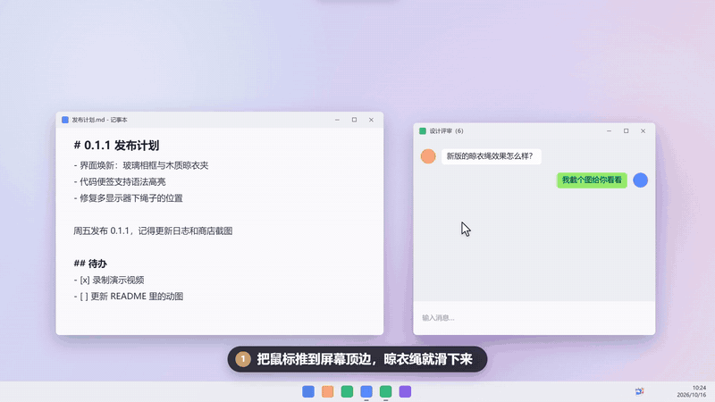

<p align="center">
  
</p>

<h1 align="center">Clipline</h1>

<p align="center">
  把截图、录屏和复制过的文字挂在屏幕顶边的一根绳子上。<br>
  鼠标碰一下顶边它就滑下来，拿走、拖走、打开，都在手边。
</p>

<p align="center">
  Windows 10 2004 及以上 / Windows 11 · x64 与 ARM64 · WinUI 3 + .NET 10
</p>
<p align="center">
  <a href="docs/demo/clipline-demo.mp4">
    
  </a>
  <br>
  <sub>点击观看完整演示视频（55 秒）</sub>
</p>


---

截图之后，图片通常就躺在某个文件夹里，要用的时候还得去翻；复制过的文字更是复制下一段就没了。
Clipline 把它们晾在屏幕顶边：截完图，新照片落到绳上晃两下；复制的文字像便签一样夹在绳子的另一侧。
要用的时候把鼠标推到屏幕顶边，绳子滑下来，单击复制、拖进聊天窗口，或者直接丢进回收站。

## 下载

| 方式 | 适合 |
|:--|:--|
| **Microsoft Store** | 由商店安装和自动更新，卸载后不留痕迹 |
| `Clipline-<版本>-<架构>-setup.exe` | **安装版**。默认只为当前用户安装，不需要管理员权限，自带卸载程序，约 7 MB |
| `Clipline-<版本>-<架构>-portable.zip` | **免安装版**。解压即用，什么都不用装；设置和数据保存在同目录的 `data` 文件夹，可以放在 U 盘上，约 25 MB |

安装版和免安装版在 [Releases](../../releases) 下载，各分 x64 和 ARM64（骁龙笔记本等选 `arm64`）。

三种方式都已经带上 .NET，不用另外安装。界面运行时 **Windows App Runtime 1.7** 的处理各不相同：

- **免安装版**把它一起打包了，在没有联网、不能装软件的电脑上也能直接运行，所以体积大一些；
- **安装版**用系统里共享的那一份（很多电脑装其他应用时已经装过），缺少时安装程序会从微软下载并安装；
- **Microsoft Store** 自动补齐。

也可以手动安装运行时：[x64](https://aka.ms/windowsappsdk/1.7/latest/windowsappruntimeinstall-x64.exe) · [ARM64](https://aka.ms/windowsappsdk/1.7/latest/windowsappruntimeinstall-arm64.exe)。

## 怎么用

鼠标停在屏幕顶边（两端角落除外，留给最大化窗口的关闭按钮），晾衣绳在该屏幕滑下，移开就收起。
也可以按快捷键（默认 Ctrl+Alt+T）或单击托盘图标显示、隐藏。绳子总在其他窗口之上，不会被正在用的程序挡住；
它也不抢焦点，放下来时键盘仍留在原来的程序里。绳子下方的开关在 **截图** 和 **文字** 两侧之间切换。

### 截图和录屏

| 操作 | 效果 |
|:--|:--|
| 截图（Win+Shift+S / Win+PrtScn）或录屏 | 新照片落到绳上并摆动，绳子自动下来一会儿 |
| 单击 | 复制图片；录屏复制为文件 |
| 双击 | 用默认程序打开（不会顺带复制） |
| 长按 | 图片用"编辑"方式打开（通常是画图）；录屏打开裁剪窗口 |
| 拖进应用 | 发送副本，照片留在绳上 |
| 拖进文件夹或回收站 | 移过去，照片离开绳子 |
| 点左上角的图钉 | 置顶：排在最前面，不会因为超出数量被取下，下次启动也会挂上 |
| 点 × | 从绳上取下（文件不动；剪贴板截图的副本移到回收站） |
| 滚轮 / 触控板横滑 | 翻看放不下的照片 |

会挂上的截图：

- **截图文件夹**：Windows 默认的 `图片\屏幕截图`，可以在设置里换成别的文件夹。
- **录屏**：Snipping Tool 的保存位置，文件夹名随系统语言变化（中文系统是 `视频\屏幕录制`）。
- **Xbox Game Bar**：Win+Alt+PrtScn 截图和 Win+Alt+R 录像，存在 `视频\Captures`。
- **只在剪贴板里的截图**：Snipping Tool、Snipaste、PixPin、ShareX 等工具，以及 QQ、微信、企业微信自带的截图，复制到剪贴板、没有存成文件的，会存成 PNG 再挂上。
  浏览器和聊天里复制的图片不算；截图工具同时存了文件的（Snipping Tool 默认如此），只挂那个文件，不重复。
  这些 PNG 存在 Clipline 的数据文件夹里，默认超过 30 天移到回收站，天数可以在设置里改，设成 0 就不清理。

### 复制过的文字

复制的文字像便签一样夹在「文字」一侧，最新的在最前面。

| 操作 | 效果 |
|:--|:--|
| 单击 | 再次复制 |
| 双击 | 看全文，便签从夹子处展开（不会顺带复制）；可以选中其中一段复制，Esc 关闭 |
| 长按，或点图钉 | 置顶 |
| 拖进应用 | 直接放入文字 |
| 点放大镜 | 展开搜索框：空格分隔多个关键字，回车复制第一条，Esc 清空 |
| 点 × | 删除这条 |

链接、邮箱、路径、颜色和代码会被认出来，各有自己的图标和样子：
链接和邮箱单独显示标题，颜色显示色块，代码写在深色编辑器底上并带语法高亮。
代码双击看全文时也是编辑器的样子：带行号，长行不换行，滚轮上下滚动，Shift + 滚轮左右滚动。
密码管理器复制的密码（以及其他声明不进剪贴板历史的内容）不会记录。

置顶的截图和文字都排在最前面，也不会被自动清理。置顶数量有上限，截图默认 3 张、文字默认 5 条。

### 动起来的方式

所有动画来自同一个实时物理模拟，彼此相互影响：

- 绳子是一根有张力的弦，由一串小质点组成，按波动方程运动。照片落上去，波会往两边传；挂得越多、越重，垂得越深，弹得也越慢。
- 每张照片和便签都是挂在木夹子上的刚体摆，转动惯量按它自己的尺寸算。夹子在绳上滑动、绳子上下弹、整条绳落下来，都会让它摆起来；它的摆动也会反过来拉绳子。
- 风一阵阵轻轻沿着绳子吹过去，远处的照片晚一点才动；风停的时候照片会静下来，模拟也跟着休眠，不占 CPU。
- 鼠标扫过照片，按实际速度和接触点推它；划过绳子会拨动绳子；点击会把照片往里按，绳子跟着一沉。
- 新截图从上方掉下来被绳子接住；点 × 时夹子松开，照片掉下去，绳子弹回去。相邻照片摆得太大会碰在一起，然后弹开。
- 开了"减少动画"就没有风和摇摆，照片直接停到位。

## 设置

托盘图标右键 → 设置，或者在已经运行时再启动一次 Clipline。所有设置改了立即生效：

| 分组 | 可以改的 |
|:--|:--|
| 晾衣绳 | 鼠标停在顶边时放下、停留多久才放下、有新截图时放下、全屏时保持安静、同时显示几张、绳上最多保留几张、最多置顶几张、启动时挂上最近几张 |
| 截图来源 | 截图文件夹、录屏及其文件夹、剪贴板里的截图及其自动清理天数、Xbox Game Bar |
| 文字 | 记录复制的文字、最多保留几条、超过几天自动删除、最多置顶几条、清空历史 |
| 快捷键 | 显示或隐藏晾衣绳的组合键（可以直接录制） |
| 外观和启动 | 主题、减少动画、登录 Windows 时启动 |

设置页底部的「关于」里有当前版本和完整的更新日志。

设置、日志、文字历史和剪贴板截图保存在：

| 版本 | 位置 |
|:--|:--|
| 安装版 | `%LOCALAPPDATA%\Clipline` |
| 免安装版 | `Clipline.exe` 旁边的 `data` 文件夹（删掉 `portable.txt` 就改用上一行的位置） |
| Microsoft Store | `%LOCALAPPDATA%\Packages\<包名>\LocalState`，卸载时一并删除 |

## 从源码构建

需要 [.NET 10 SDK](https://dotnet.microsoft.com/download)（`winget install Microsoft.DotNet.SDK.10`），不需要 Visual Studio。
运行还需要上面提到的 Windows App Runtime 1.7。

```bash
dotnet run --project src/Clipline
```

加上 `-- --settings` 会在启动时直接打开设置。

### 本地打包

`build/build.ps1` 和 GitHub Actions 用的是同一个脚本，产物放在 `artifacts/`：

```bash
pwsh build/build.ps1
```

```bash
pwsh build/build.ps1 -Target exe -Arch x64,arm64
```

| 参数 | 说明 |
|:--|:--|
| `-Target` | `all`（默认）、`exe`（安装版 + 免安装版）、`installer`、`portable`、`msix`，可以写多个 |
| `-Arch` | `x64`（默认）、`arm64`，可以写多个 |
| `-OutputDir` | 产物目录，默认 `artifacts/` |
| `-MsixIdentityName` / `-MsixPublisher` / `-MsixPublisherDisplayName` | Microsoft Store 的包标识，见下文；也可以用同名的 `MSIX_*` 环境变量 |

| 产物 | 说明 |
|:--|:--|
| `Clipline-<版本>-<架构>-setup.exe` | 安装版，需要 [Inno Setup 6](https://jrsoftware.org/isinfo.php)（`winget install JRSoftware.InnoSetup`） |
| `Clipline-<版本>-<架构>-portable.zip` | 免安装版，带上了 Windows App Runtime（`WindowsAppSDKSelfContained=true`） |
| `Clipline-<版本>.msixbundle` | 提交到 Microsoft Store 的包，同时含 x64 和 ARM64；只打一种架构时是 `Clipline-<版本>-<架构>.msix` |

MSIX 不签名：上传到 Partner Center 后由 Microsoft Store 签名再分发，所以本地打出来的包不能直接双击安装，只用来提交。

## 发布新版本

版本号只写在一个地方：`Directory.Build.props` 的 `VersionPrefix`。更新日志在 [`CHANGELOG.md`](CHANGELOG.md)，
设置页的「更新日志」和 GitHub Release 的说明都直接取自它。

1. 平时把改动记在 `CHANGELOG.md` 的 `## [Unreleased]` 下。
2. 发版时把这些条目移到新的 `## [x.y.z] - YYYY-MM-DD` 标题下，并把 `VersionPrefix` 改成 `x.y.z`。
3. 提交后推送标签：

   ```bash
   git tag v0.2.0 && git push origin v0.2.0
   ```

[Release 工作流](.github/workflows/release.yml) 会检查标签和版本号一致、更新日志里有这一版，然后构建 x64 和 ARM64 的安装版和免安装版，
生成 SHA-256 校验文件，以该版本的更新日志为说明创建 Release。也可以在 Actions 页面手动运行它，默认建成草稿。

版本号带后缀（如在 `Directory.Build.props` 里加 `<VersionSuffix>beta.1</VersionSuffix>`）时会发成预发布版本。

### 提交到 Microsoft Store

商店的包要用 Partner Center 为应用保留的身份。在 Partner Center 的 **产品管理 → 产品标识** 里找到这三个值，
填到仓库的 Settings → Secrets and variables → Actions → **Variables**（不是 Secrets，它们不需要保密）：

| Variable | 对应清单里的 | 例子 |
|:--|:--|:--|
| `MSIX_IDENTITY_NAME` | `Package/Identity/Name` | `12345Publisher.Clipline` |
| `MSIX_PUBLISHER` | `Package/Identity/Publisher` | `CN=XXXXXXXX-XXXX-XXXX-XXXX-XXXXXXXXXXXX` |
| `MSIX_PUBLISHER_DISPLAY_NAME` | `Package/Properties/PublisherDisplayName` | `Publisher` |

配置好以后，每次发版工作流会多打一个 `Clipline-<版本>.msixbundle`，作为名为 `Clipline-<版本>-store` 的工作流产物上传（不放进 Release）。
下载后在 Partner Center 新建提交，上传到「程序包」即可。没有配置这些变量时，这一步会跳过。

几点要注意：

- 版本号的第四段固定为 0（`x.y.z.0`），这是商店的要求；同一个版本号不能重复提交。
- 应用用了 `runFullTrust` 受限功能，提交时需要在说明里写明用途（桌面应用需要读取截图文件夹和剪贴板）。
- 第一次提交用了 `.msixbundle`，之后也要一直用 bundle。

## 项目结构

```
.
├── .github/workflows/
│   ├── ci.yml                  PR：编译 x64 与 ARM64，检查更新日志
│   └── release.yml             推送 v* 标签：打包、发布 Release，并产出商店用的 msixbundle
├── build/
│   ├── build.ps1               本地和 CI 共用的打包脚本
│   ├── version.ps1             读取版本号、从更新日志提取发布说明
│   ├── installer/              Inno Setup 安装程序脚本和简体中文语言文件
│   └── icon/                   图标的 SVG 源文件和 make-icon.ps1
├── docs/                       图标预览等文档图片
├── src/Clipline/
│   ├── App.xaml(.cs)           启动、单实例、日志、全局资源
│   ├── Package.appxmanifest    MSIX 清单（版本号和商店身份在构建时填入）
│   ├── Assets/                 程序图标；Package/ 下是 MSIX 磁贴
│   ├── Core/                   设置、应用信息、更新日志解析、文字历史与分类、置顶、代码高亮
│   ├── Views/                  晾衣绳窗口、照片和便签卡片、夹子、全文阅读、设置、录屏裁剪
│   ├── Physics/                绳子、摆动、风和碰撞的物理模拟
│   ├── Captures/               监听截图和录屏文件夹、剪贴板截图和文字、视频缩略图
│   └── Platform/               Win32 调用、托盘和快捷键、开机启动、主题和窗口外观
├── CHANGELOG.md                更新日志（应用内和 Release 共用）
├── Directory.Build.props       版本号
├── global.json                 .NET SDK 版本
└── Clipline.slnx
```

改了 `build/icon/` 里的 SVG 后，运行 `pwsh build/icon/make-icon.ps1` 重新生成 `.ico` 和 MSIX 磁贴（用系统自带的 Edge 渲染）。

## 还没做的

- 界面多语言（目前只有简体中文）
- 应用内检查更新

## 致谢

Clipline 是 [Tendedero](https://github.com/alejandrobujan/tendedero) 的 Windows 版本，玩法和"晾衣绳"的创意都来自它。感谢 Alejandro Buján。

## 许可

[MIT](LICENSE)
